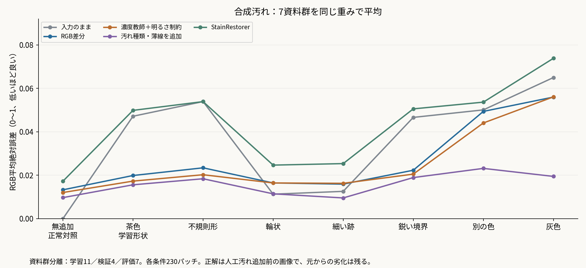

# 接触シミと読みやすさ：2時間の追加作業報告

2026-10-07。開始18:46 JST。方針を先に固定し、実例の追加探索、既存手法との比較、学習試作、失敗原因の診断を実施した。最終実施時刻・検証結果は `session_complete.json` と `verification.json` に記録する。

## 1. 今回の結論

**文字に重なるシミの候補は別資料にも増やせた。単純なSauvola二値化やDocResで改善する例が多く、接触シミが取れたことだけでは新手法論文の差を示しにくい。**

研究の軸は「文字に重なる汚れの除去と、観測できる細字・注記・色情報の保持、必要な場所だけの修正」を一つの課題として検証するのが妥当。ただし今回、これらを同時に一般化した方法は完成していない。専門家による読解改善も未評価である。

「一般化＋別の課題をもう一つ」は論文の必須の数え方ではない。一般化は有効性を示す条件であり、追加の貢献は同じ問題の中で既存手法が両立できない点を解く形でもよい。候補は、単純な二値化では保存しづらい弱い情報と、修正しなくてよい箇所を守る判断である。これが実際の古文書で必要であり、既存法より優れるという証拠は、まだ必要。

最初に見る資料：[進捗報告用の短縮版](進捗報告_短縮版.md)、[代表比較・要点PDF](接触シミ_2時間検証.pdf)、[原寸の別資料改善例N01](evidence/N01_full_native.png)、[手法の実例比較](real_models/N01/comparison.png)、[合成評価](figures/01_synthetic_domains.png)。比較の一次成果物はPNG。

## 2. NPJから何が進んだか

|項目|以前の到達点|今回進んだこと|まだ言えないこと|
|---|---|---|---|
|孤立シミ|既知画像を見た後に手指定マスクを調整して局所除去|接触シミとは別の条件であることを明確化|孤立シミ除去の自動一般化は未証明|
|接触シミ|主にhnsd007の既知例、単純なマスク解除は穴や残留を作る|別資料の接触候補6ページを追加し、共通条件の方法を比較|読解改善・真の筆画保持・汚れの材質分類は未注釈|
|切り出し依存|768pxフレーム等での局所比較|25ページの原寸全ページで、保存黒マスクとSauvolaマスクを同じDDRM条件で比較|論文の完全再現ではない|
|自動局所修正|手指定範囲内の成功|原画像とNPJ系出力の不一致から範囲を自動推定、マスク外を画素一致で保持|範囲不足、縁の残留、小シミ見落とし、不要な修正が残る|
|学習|合成CNNの安定性・実画像への転用が課題|資料群を分離してRGB差分と濃度補正を試作。濃度教師でゼロ補正への崩壊を回避|合成での改善を実物の一般化と扱えない|
|マスクの役割|黒マスクの誤分類と劣化マスク未使用を診断|茶色いシミが赤文字マスク経由で原画像から貼り戻される例を画素で確認|赤を厳しく判定するだけでは薄い朱印を守れない|

以前の詳細：[NPJからの進捗報告](../npj_progress_report_20261007/進捗報告.md)。孤立斑点の既知例では、最終手指定範囲7,259画素、変更7,227画素、指定外0。結果を見た後の手調整なので、一般化した成果には数えない。

## 3. 今回実施した範囲

- hnsd007の50ページを除いた**6,022ページ**を、原画像の色と形から機械的に候補探索。これはシミの正解分類や有病率の集計ではない。表紙、挿絵、裏写り、穴、普通の紙色が多く混じった。
- 途中選択26ページと追加選択68ページ、計**94ページ**を原画像・保存マスクで目視確認。両選択は重複させていない。本文接触候補、本文に近いだけのシミ、細字の対照、材質不確定例を区別した。
- 前回の9ページ、今回の6ページ、原画像から追加選択した10ページを合わせ、**25ページ・11資料群**を比較。最後の10ページは出力を見る前に対象・条件を固定した。試作CNNの学習・検証資料群との重複はない。基準DDRMや外部モデルの元の学習資料との非重複は確認していない。
- 原寸全ページのNPJ系基準と、原画像のSauvola黒マスクに替えた同一DDRMを比較。赤マスクは両条件で保持した。25ページ×2条件の全ページ処理が完了。
- Sauvolaの4共通設定、形態学的背景推定、log背景の3スケール、DocRes、StainRestorer、自動範囲の局所置換、6回の小規模学習試作を検証した。学習試作の3回はゼロ補正に崩壊し、不採用。

### 比較条件の限界

「NPJ系基準」は10月2日時点の凍結したローカル派生コード、既存文字モデル、紙面参照、保存済みCSCマスクを使う対照である。原画像をPNG化して入力し、128pxパッチ、重なり32px、20ステップ、seed999を共通とした。ACE入力を含む論文全工程の厳密な再現ではない。

同じ乱数初期値でも、マスクの条件分岐で消費する乱数の形が変わるため、黒マスクの変更を全時刻の同一ノイズで比較した実験ではない。赤マスクだけの変更では黒マスク・DDRMは共通で、変更が除外された赤マスク内に限定されることを別途検証した。

StainRestorerは著者モデル・StainDoc重みの原寸タイルと256px条件を比較した。[DocRes](https://arxiv.org/abs/2405.04408)は[著者実装](https://github.com/ZZZHANG-jx/DocRes)の構造にコミュニティミラーの重みを使っており、著者配布ファイルとの同一性は独立に確認していない。今回の方法適用を各論文の公式ベンチマーク再現とは呼ばない。

## 4. 中心に置ける実例

接触候補は**計12ページ・5資料群**。この数は成功数ではない。今回追加した6ページはN01、N02、F39、F48、F60、F62で、hnsd007以外の4資料群に属する。[ページ全体と切り出し位置](figures/07_contact_page_contexts.png)、[候補一覧CSV](contact_candidates.csv)。

|ID|ページ|探索時期|画像|
|---|---|---|---|
|T00|hnsd007_042|以前の候補|[全ページ比較](full_comparisons/T00.png) / [原画像からの各手法](real_models/T00/comparison.png)|
|T01|hnsd007_023|以前の候補|[全ページ比較](full_comparisons/T01.png) / [原画像からの各手法](real_models/T01/comparison.png)|
|T02|hnsd007_025|以前の候補|[全ページ比較](full_comparisons/T02.png) / [原画像からの各手法](real_models/T02/comparison.png)|
|T03|hnsd007_022|以前の候補|[全ページ比較](full_comparisons/T03.png) / [原画像からの各手法](real_models/T03/comparison.png)|
|T04|hnsd007_026|以前の候補|[全ページ比較](full_comparisons/T04.png) / [原画像からの各手法](real_models/T04/comparison.png)|
|T06|hnsd007_043|以前の候補|[全ページ比較](full_comparisons/T06.png) / [原画像からの各手法](real_models/T06/comparison.png)|
|N01|200010454_00003_2|今回追加|[全ページ比較](full_comparisons/N01.png) / [原画像からの各手法](real_models/N01/comparison.png)|
|N02|200021071_00032_1|今回追加|[全ページ比較](full_comparisons/N02.png) / [原画像からの各手法](real_models/N02/comparison.png)|
|F39|200021086_00013_1|今回追加|[全ページ比較](full_comparisons/F39.png) / [原画像からの各手法](real_models/F39/comparison.png)|
|F48|200021071_00070_2|今回追加|[全ページ比較](full_comparisons/F48.png) / [原画像からの各手法](real_models/F48/comparison.png)|
|F60|200019865_00109_1|今回追加|[全ページ比較](full_comparisons/F60.png) / [原画像からの各手法](real_models/F60/comparison.png)|
|F62|200010454_00003_1|今回追加|[全ページ比較](full_comparisons/F62.png) / [原画像からの各手法](real_models/F62/comparison.png)|

**N01は中心例に向いている。** 原画像で細い曲線に茶色い円形跡が重なり、NPJ系出力では黒い塊になる。共通Sauvolaマスク＋DDRMで塊が減り、曲線を追えるようになる。自動局所置換では輪郭の黒残りがある。[同位置・整数2倍PNG](evidence/N01_full_native.png)。

T01等でも同じ傾向を全ページ処理で確認した。[原寸比較](evidence/T01_full_native.png)。一方、多くの原画像では文字自体が既に見えている。「元から読めない文字を復元した」というより、「基準処理が作る黒い塊を避けた」例が中心である。原画像との比較を評価から外さない。

F62でも文字に重なる塊は減るが、小さな黒残りとページ上端の余計な黒線が出た。自動局所修正も文字周辺に断片を残す。F60の小さな茶色い跡は黒い小片として残り、F48の広い茶色い部分は赤マスクを保持した比較では残った。候補が増えたことと、完全な除去ができたことを分ける。[F62精細図](evidence/F62_full_native.png)、[F60全ページ処理比較](full_comparisons/F60.png)、[F48精細図](evidence/F48_full_native.png)。

N03は二値化で薄い灰色の像がほぼ消えるが、表の筆画か裏写りか未確定。筆画保持失敗の確定例や本文接触の主評価には数えない。[比較](real_models/N03/comparison.png)。N05・F35・F41・F65・F67は細字・小文字の保存対照として使う。[N05精細図](evidence/N05_thin_native.png)。N05では主要な細い曲線は二値化でも残っており、今回の対照から重大な読解損傷を断定しない。

F47とF59は、シミが文字の近くにあるだけの対照。T05も影響が小さい。T07は物理損傷の疑い、C01・N04・N06は材質や表裏が不確定なので、接触シミの成功・失敗率に混ぜない。

## 5. 成功した方法と失敗した方法

ここでの「改善」は画像上の観察または合成正解との誤差低下。読解の正解率ではない。

|方法|改善できたこと|失敗・限界|現時点の扱い|
|---|---|---|---|
|Sauvola共通条件 w61, k0.2|複数資料の接触シミと文字を分ける。全ページの黒マスク置換でも塊が減る|小さな残留、薄い人工線の消失、色と濃淡を保持しない|必須の単純比較。これで済む例だけなら新規性は弱い|
|DocRes二値化|接触シミを落とし、細い曲線や小文字を抽出する例が多い|色・濃淡の保存ではない。薄い灰色像も除く。古文書での読解GTなし|必須の既存比較。局所修正の候補にもなる|
|自動範囲＋局所二値化|マスク外はNPJ系出力と完全一致|広い縁や断片的なシミを拾い切れない。小シミで無作用、低優先シミに作用する場合もある|自動局所化の試作。汚れ分離の完成ではない|
|log低周波背景補正|広い色むらを弱める|文字周辺の明るい縁、シミの高周波境界、スケール依存|周波数・スケール分離の比較。単独解決はしない|
|StainRestorer生RGB|著者モデルの固定適用条件を追加確認|今回の古文書では緑寄りの紙色と模様状の色むら。合成茶色でも入力より誤差が大きい条件|今回条件では直接採用しない。モデル一般の否定ではない|
|RGB差分CNN|学習型の人工茶色シミで誤差低下|正常部分を変える。形・色の変化で効果が弱くなり、実物の残留も大きい|合成学習の比較試作|
|明るさ制約・元のL1学習|観測画素の形を動かさないという設計を試せた|3つの初期化・損失試行で補正量0に崩壊|最適化失敗。制約が不可能という証拠ではない|
|濃度教師＋明るさ制約|既知の人工汚れ濃度を学ばせると崩壊を回避|正常部分も変化。実例で白い斑、輪状・灰色等への弱さ|局所可能性を示す試作。筆画保存保証ではない|
|汚れ種類・薄線の合成追加|色や形の変化に対する合成誤差が低下|実物の白い斑は残る。微小斑点では入力より悪い|旧評価を見てからの探索的改良。独立評価と呼ばない|
|文脈・スケールを広げた濃度推定|白い斑が滑らかになる例|大きなシミを十分には除去しない。正常部分保持は保証なし|文脈不足だけで説明できないという診断|

### 濃度学習が崩壊した理由

固定バッチのCPU float32でも、初期の微小補正が汚れ以外の多数の画素を変えると、全体L1の勾配が補正を下げる側に変わった。非負clampを使う試作はその後負側へ入り、勾配0となった。これは今回の初期化・損失・データに関する診断であり、一般的な不可能性の証明ではない。人工汚れの濃度MSEを教師にすると学習は進んだ。[診断記録](learned/gain_diagnosis.json)。

## 6. 赤マスクが汚れを貼り戻す問題

保存済み赤文字マスクは、推論後に原画像を貼り戻す範囲。N02の768pxフレームでは80,075画素、N03では64,435画素を覆っており、茶色い跡も含む。赤マスクだけを既存の厳しいHSV規則で除外すると、変更はその範囲内だけに起こり、範囲外は0画素。元の赤マスク内は基準出力と原画像が画素一致した。[機構の検証](red_filter_study/overlay_mechanism_verification.json)。

黒マスクをSauvolaに替えても、赤マスクが同じなら茶色は貼り戻される。N02では黒文字マスクの問題と、色の保護マスクの問題を分けて対処する必要がある。[比較](evidence/N02_red_native.png)。

ただし既存の絶対色規則（HSV H≤12またはH≥168、S>180、成分支持率≥0.05）は、F41の薄い朱印候補もほぼ外す。全ページでは保存赤候補95,906画素のうち、原画像で350画素、ACE後の保存分類入力で798画素しか残らない。入力空間の違いだけでは説明できない。F41の基準も朱印の一部を黒として出しており、赤マスクの厳格化だけの問題ではない。**赤マスクを単純に捨てることは採用しない。** [同位置の結果](evidence/F41_red_native.png)、[全ページの候補範囲](red_audit/F41/whole_page.png)。

この除外診断のDDRM比較は原画像の色規則を保存候補マスクに適用した。分類入力でも別途確認し、比較フレーム内の残存はN02・N03とも0画素、F41では原画像0画素／分類入力7画素だった。これは保存候補に対する成分規則の監査であり、CSC分類器全体を再実行した結果ではない。[入力空間の全ページ確認](red_audit/input_space_check.json)、[同フレームの確認](red_audit/crop_input_space_check.json)。

## 7. 合成評価：何が一般化し、何がしていないか

学習11資料群384パッチ、検証4資料群144パッチ、評価7資料群230パッチ。資料群を分離し、実接触シミを学習・チェックポイント選択に使っていない。資料群にはコレクション名もあるため、完全な独立書籍の単位とは限らない。

正解は「人工汚れを足す前の原画像」であり、元からある汚れ・裏写りは残る。数字は**資料群ごとにパッチ平均を取り、7群を同じ重みで平均したRGB MAE（0〜1）**。低いほどよい。読解率や本物のシミ除去の指標ではない。

|人工条件|入力|RGB差分|濃度教師|種類・薄線追加|StainRestorer|
|---|---:|---:|---:|---:|---:|
|無追加・正常対照|0.00000|0.01327|0.01203|0.00968|0.01725|
|学習型の茶色|0.04717|0.01986|0.01729|0.01558|0.04987|
|不規則形|0.05392|0.02341|0.02022|0.01837|0.05391|
|輪状|0.01127|0.01643|0.01643|0.01142|0.02466|
|細い跡|0.01256|0.01590|0.01626|0.00953|0.02535|
|鋭い境界|0.04664|0.02229|0.02050|0.01891|0.05056|
|別の色|0.05009|0.04939|0.04406|0.02314|0.05366|
|灰色|0.06499|0.05600|0.05608|0.01945|0.07385|

RGB差分と茶色中心の濃度学習では、色・灰色・輪状への変化に弱い。種類を増やすと合成誤差は下がるが、この改良は旧評価を見て設計した。色・形の旧条件について独立テストへの一般化が新たに証明されたとは扱わない。

追加の未学習合成条件も固定した。位置で色が変わる濃度場では改善した一方、1〜3pxの微小斑点では全試作の誤差が入力より増えた。不透明な色の混合ではインクも明るくなり得るため、明るくするだけの補正には理論上回復できない成分がある。この人工条件を本物の汚れの物理モデルと断定しない。[追加条件の図](figures/04_stress_domains.png)。

無追加の正常対照でも誤差が出る。濃度場の乗算は、位置を再描画しなくても濃さや細線のコントラストを変える。**「生成しない」「明るさだけ」は、筆画保持の保証ではない。** [正常保持との両立](figures/02_preservation_tradeoff.png)。

### 人工線の保存

7評価資料群の平滑化紙面に、既知の1.25px曲線を灰色・茶色、4コントラストで描き、汚れなし／人工汚れあり計112条件を比較した。実際のくずし字ではない。

Sauvola w61, k0.2では、汚れなしの6%・12%コントラスト灰色線の既知線領域を検出しなかった。DocResは線を多く残した。一方、RGB濃度補正では「線を入れた場合と入れない場合」の応答が正解より大きくなることがあり、残存だけで保存成功と数えられない。[図](figures/03_controlled_strokes.png)。

この実験は、単純な二値化に弱い条件が存在することを示す。ただし、**古文書で同程度の必要な筆画が消える実例と読解損失は、まだ確定していない。** N03の灰色像の表裏・材質確認が必要。N05等では主要線が残るため、成功例に都合のよい説明を付けない。

## 8. 周波数の方法に向かいやすい理由

広い紙色・照明・シミは比較的ゆっくり変わり、文字の細い縁は速く変わるため、低周波の背景と高周波の線を分ける発想が有効になりやすい。Gaussian背景補正、形態学的背景推定、局所統計による二値化も、この空間スケール差を利用する。

ただし、シミの境界は高周波を持ち、太い文字や薄い広い筆記は低周波も持つ。同じ色・スケールのインクとシミは周波数だけでは区別できない。今回のlog補正ではシミの縁と文字周囲の明るい縁が残った。[N01](frequency/N01/comparison.png)。

乗算的な吸光を仮定すると、観測画像のlogは元画像のlogと汚れ濃度の差になる。今回の濃度学習もその仮定を使うが、不透明混合や情報の欠損まで扱うものではない。最終的に必要なのは、スケール分離に加え、保存すべき情報・汚れの機構・処理の必要性の判断である。

## 9. 論文化に向けた判断

**現状：NPJ後処理の実用改善として検証する価値はあるが、新手法論文としての優位は未確認。** 自動化された共通条件の改善は前進だが、既知のSauvolaやDocResで解ける部分を新規成果と数えない。

次はモデルを大きくする前に、今回の候補から次の三つを確かめる。

1. **原画像・NPJ系基準・Sauvola・DocResの間で、実際に読める文字数や読解時間に差があるか。** 新規修復器より先に、改善の必要性を検証する。
2. **既存二値化が消す、保存すべき薄い本文・注記・色のある筆記を実物で確定する。** 裏写り・紙の傷・朱印・本文を分け、専門家と原資料情報で確認する。今回の薄い像は未確定。
3. **対象と条件を固定し、未使用の資料で必要箇所だけを直せるか。** 接触例だけでなく近接シミ・正常細字を含め、除去と過剰編集の両方を評価する。

主張候補は「原画像に残る情報を使い、NPJ系処理の読みやすさ低下を必要な箇所だけで修正し、弱い筆記を保つ」。この両立を既存法より良く示せれば、無関係な劣化課題を追加するより一貫した貢献になる。ただし、原画像＋基準出力を使うため原画像単独の方法より多い情報を使っていること、単なるマスク修正や既存モデルの組み合わせとの差を明記する必要がある。

読解差が小さい、またはDocResで十分なら、このシミ除去だけを軸に大規模な新モデル開発へ進む根拠は弱い。マスクの品質監査・安全な後処理として位置付けるか、実際の読解課題を再定義する。

## 10. 関連研究と成果物

[NPJ論文](https://www.nature.com/articles/s40494-025-02214-8)は色空間マスクとDDRM、文字に重なるシミや色の保存を既に扱う。[StainRestorer / WACV 2025](https://arxiv.org/abs/2410.22922)も文書内容保持を目的としたシミ除去を扱う。[Risk-Aware Manchu Manuscript Restoration](https://arxiv.org/abs/2609.36243)は2026年9月のプレプリントで、筆画と修復の選択を扱う。薄線保持や局所ゲートという名称だけでも新規性は確立しない。投稿先に応じた詳細な関連研究比較が必要。

- [研究方針](研究方針.md)、[読解評価の実施案](読解評価の実施案.md)
- [要点PDF](接触シミ_2時間検証.pdf)、[画像と記録のZIP](接触シミ_2時間検証_資料.zip)
- `full_comparisons/`：25ページの全ページ処理後の同位置PNG
- `real_models/`、`real_augmented/`：原画像からの各方法と学習改良の比較
- `evidence/`：代表例の原寸／整数倍PNG。画素値、座標、元ファイルSHA256を記録
- `synthetic_eval/`、`stress_eval/`：パッチ記録・資料群平均・CSV。実物の読解の正解ではない
- `reading_packet/`：今後の読解評価用画像と入力票。評価は未実施
- `verification.json`：ソース不変、全ページ寸法、原入力、マスク外保持、作図を検証

本番コード、元画像、既存重み、以前の報告は変更していない。今回の成果はこの作業ディレクトリ内に保存した。
