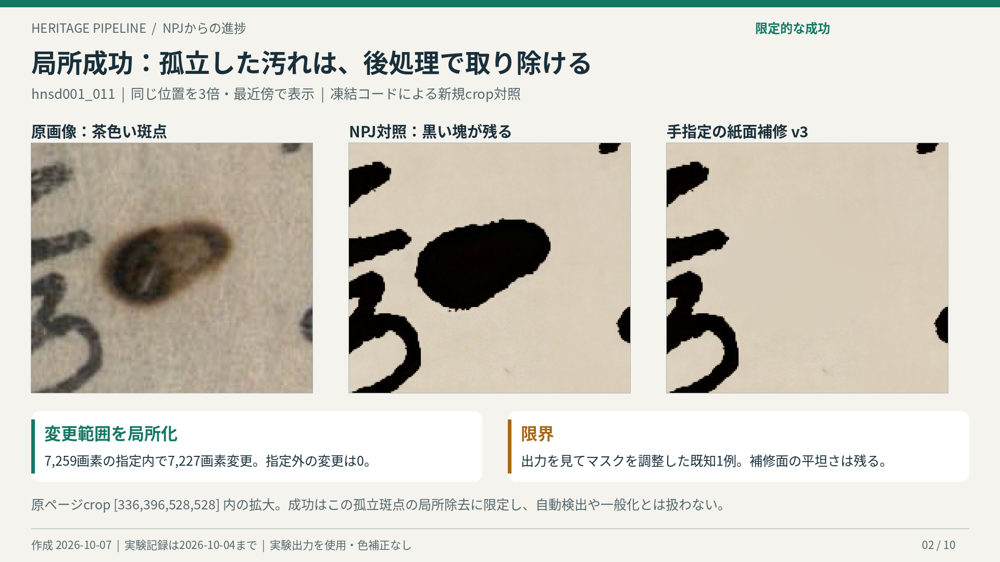
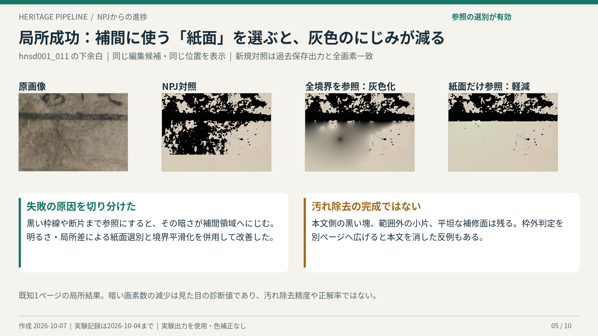
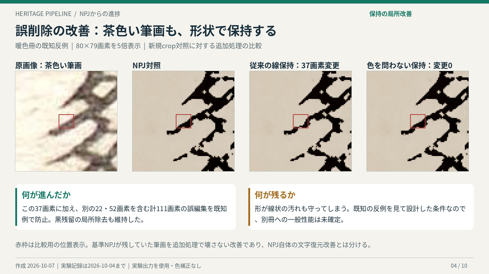
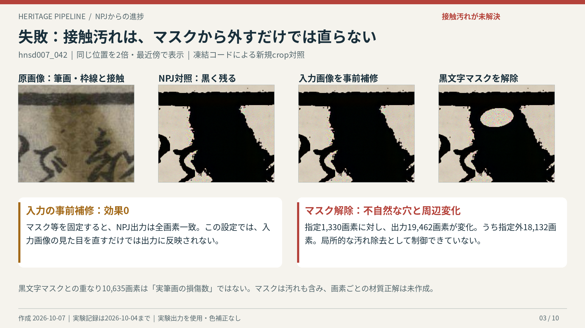
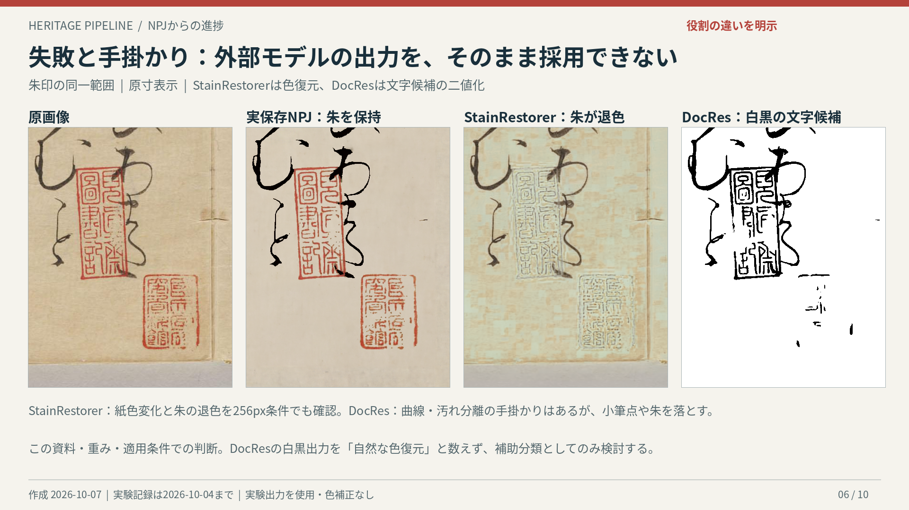
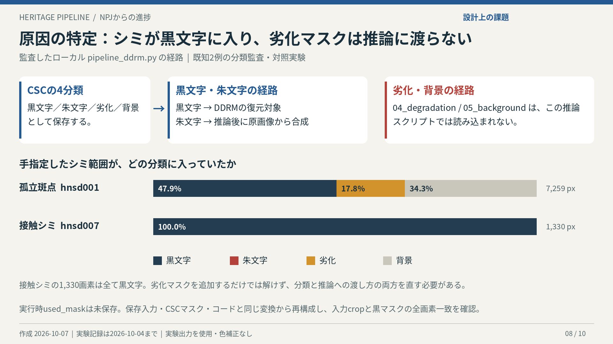
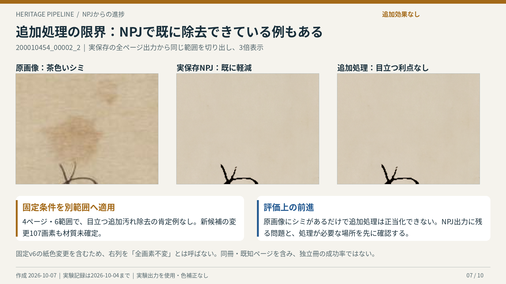

# NPJからの進捗報告

作成日：2026-10-07／実験記録の確認範囲：2026-10-04まで。保存実験とコードを整理した報告であり、今回新しいモデル推論や学習は実施していない。

## 1. 報告の要点

**NPJ以後、比較条件の整備、CSC分類と推論の接続の診断、孤立汚れの局所除去、追加処理による筆画誤編集の抑制まで進んだ。現在の中心課題は、文字に接触した汚れを安全に分離することと、別冊でも追加効果が得られることの確認である。**

「NPJを全面的に上回る新手法が完成した」とはまだ言えない。一方、失敗を汚れ候補の検出、筆画保護、マスクの使い方、紙面の補修に分け、どこを直すべきかを具体化できたことが研究上の進展である。

- **できたこと**：孤立斑点を手指定マスク内で除去。補間参照から黒い枠線等を除き、灰色のにじみを軽減。既知の茶色い筆画の誤編集111画素を防止。
- **原因が分かったこと**：シミが黒文字に入る例があり、監査したローカル推論では保存済みの劣化・背景マスクを読み込んでいない。原画像の事前補修だけでは出力が変わらない条件も確認。
- **躓いていること**：接触汚れと筆画を分離できない。保護すると汚れが残り、除去を強めると筆画が失われる。自然な紙色・模様・境界と、別冊での有効性も未解決。

[報告用PDF・10ページ](NPJ進捗報告_20261007.pdf)／[要約PNG](figures/01_progress_summary.png)／[主要比較の一覧](比較画像一覧.png)

## 2. NPJ時点を基準にすると、何が進んだか

基準とする論文本文は、ローカルの [npj.txt](../../npj.txt)。ACEによる色補正、色空間特徴とPCA/GMMによる分類、黒文字マスクによるDDRM誘導、朱文字の原画像からの合成、紙面参照、パッチ推論と境界混合が既に含まれる。これら自体を今回の新規成果には数えない。

論文では合成劣化に対するPSNR・SSIM・LPIPSの改善と実資料の例を示し、裏写り、薄い筆画、マスクの曖昧さ、生成痕、パッチ境界等を限界としている。**論文掲載の数値は今回の追加手法の評価値ではない。**

| 項目 | NPJ時点の構成・課題 | その後の進展 | 現在の到達範囲 |
|---|---|---|---|
| 実装と比較 | マスク・背景参照・復元器が一体で動く | 入力、保存出力、版、マスク用途を照合。背景タイリング・速度等の実装問題も整理 | 実装修正と研究上の新手法を区別できる |
| 色空間分類（CSC） | 色だけでは薄い墨、朱、茶色いシミが曖昧 | 朱の絶対色条件、明度による救済、暖色保留v6、形状による線保持を試作 | 特定の誤編集を防ぐ一方、汚れも保護する |
| 紙面の補修 | DDRM出力の黒残留、境界や生成痕 | 正常紙面の参照選別、調和補間、細模様転写・多尺度処理を比較 | 孤立・余白の局所効果。本文接触部と自然さは未達 |
| 学習済み外部モデル | 元のDDRMを中心に復元 | DocRes・StainRestorerを同じ保存例で試験し、入力差も追加対照で確認 | DocResは補助分類の手掛かり。色出力の直接置換は採用せず |
| 原因診断 | 残留が分類か復元か切り分けにくい | 手指定の汚れマスク、事前補修、黒文字マスク解除の対照と4分類監査 | 接触汚れで分類と推論への渡し方の両方が課題と判明 |
| 評価 | 合成劣化の画質指標と実画像例 | 保存NPJの再利用、同位置PNG、対照領域、画素一致・出自確認を整備 | 専門家／画素注釈と独立冊での精度評価は未完成 |

### 経緯

| 時期 | 実施したこと | 残すべき結論 |
|---|---|---|
| 7月〜9月23日の記録 | DDRM/DDNM比較、CSC修正、自己参照背景v15、速度改善、裏写り検出 | DDNMの大幅な速度優位という説明は撤回。背景参照の寄与とCSCの課題が中心へ |
| 9月30日 | 保護／編集／保留の分離、暖色保留v6、紙・筆記・汚れの層分解 | 同じ色・形の筆記と汚れは分け切れない。保留は文字の正解分類ではない |
| 10月1日 | 虫食い・余白・紙色・模様・境界の多数の試作 | 局所改善がある一方、平坦さ、残る縁、誤保護が残る |
| 10月2日 | 比較設計を監査し実保存NPJへ戻す。外部モデル、役割分離、紙面参照を比較 | 編集マスクだけの実験を通常NPJへの優位と扱わない。汚れ除去を主目的に固定 |
| 10月4日前半 | 枠・線保持の改良、別冊転用、実保存の別範囲への固定適用 | 本文誤編集と、追加効果が得られない条件を確認。一般適用を保留 |
| 10月4日後半 | 手指定汚れマスクと4分類・推論経路を監査 | 孤立汚れの局所可能性と、接触汚れの破綻を切り分けた |

初期履歴の定量値は [9月23日の記録](../status_summary_2026-09-23.md) に基づく。そこで報告された5.4倍の実装高速化、20ページ×4強度のCSC診断等は今回再計測していない。**20ページ×4強度で復元手法全体のPSNR等を比較する計画は、同記録では未実施であり、完了したベンチマークとして報告しない。**

## 3. 成功した手法・条件付きで有効な手法

「成功」は以下の範囲の観察結果を指し、自動化、正解率、別冊での一般的有効性を意味しない。

| 手法 | 成功したこと | 成功の範囲と留保 | 根拠 |
|---|---|---|---|
| 正常紙面だけを参照する調和補間 | 全境界を参照して生じた灰色のにじみを軽減 | hnsdの既知1ページ・下余白。紙面選別と境界平滑化を併用。平坦さは残る | [紙面参照の報告](../npj_dirt_clean_reference_20261002/report.md) |
| 手指定汚れマスクによるNPJ後処理 | 孤立した茶色斑点が黒い塊として残る例を局所除去 | hnsd001の既知1例。出力を見た後のマスク調整あり | [手指定試験](../npj_manual_stain_oracle_20261004/report.md)・下記訂正 |
| 色に依存しない線保持 | 茶色い筆画の37＋22＋52＝111画素の誤編集を防止し、既知の黒残留除去を維持 | 既知17範囲の開発比較。新たな汚れ除去の成功数とは数えない | [線保持の報告](../npj_colour_independent_ridge_20261004/report.md) |
| 全ページの枠・本文配置の利用 | 虫食い縁の局所除去と、以前に本文を消した反例の見送り | 既知例。枠が成立しないページでは動かず、汚れ全般には適用できない | [全ページ配置v4](../npj_full_page_layout_v4_20261004/report.md) |
| DocResの補助候補／確率 | 薄い曲線を拾い、濃い塊を文字候補から外す手掛かり。5画素の接続候補を残して副次像12画素を見送る例 | 主線らしい10画素も見送る。文字補完は現在の主目的から外れ、単独採用しない | [モデル比較](../npj_literature_trial_review_20261002/report.md)・[補助選別](../npj_docres_gap_gate_review_20261002/report.md) |
| 低域／高域分離と模様量の補正 | 混合で弱まった紙の細模様量を回復 | 自然な紙面や正しい材質の回復を示さず、淡い輪郭・色面は残る | [模様量補正](../paper_texture_blend_energy_review_notes_20261001.md) |
| CSC修正・自己参照背景v15 | 初期記録では朱誤分類の抑制、背景参照改善の効果 | 今回は履歴として記載。最新の孤立汚れ後処理と一つの完成手法に合算しない | [初期整理](../status_summary_2026-09-23.md) |

### 比較画像：孤立斑点

**今回の再集計による訂正**：旧報告本文の「最終v3：6,341画素、変更6,324画素」はv2の値だった。保存済み `hnsd001_manual_mask_v3.png` と `hnsd001_harmonic_postprocess_v3.png` をNPJ対照と再比較すると、**v3は指定7,259画素、変更7,227画素、指定外変更0**。v3の診断JSONもこの数値と一致する。既存資料・画像は上書きせず、本報告を訂正記録とする。[再集計値](verified_metrics.json)／[各版の再集計](recount_preliminary.json)

### 比較画像：紙面参照と筆画保護

筆画保護の図は「NPJが既に残していた筆画を、追加処理で壊さないようにした」例である。NPJ自体の文字復元精度を上回ったという説明には使わない。

## 4. 失敗した手法・採用を見送った手法

| 手法・仮説 | 観察された失敗・限界 | 現在の扱い・得られた知見 | 根拠 |
|---|---|---|---|
| マスク固定のまま原画像を先に補修 | hnsd007のNPJ出力が全画素不変 | この入力経路では見た目の補修だけでは黒文字復元に反映されない | [手指定試験](../npj_manual_stain_oracle_20261004/report.md) |
| シミを黒文字マスクから解除 | 白／桃色の穴、弧状の残留、周辺出力の変化 | 接触汚れを単純なマスク減算で解かない | 同上 |
| crop内の枠外判定をそのまま別冊へ展開 | 上側の枠線を下端と誤認し本文を消す | 局所位置だけでは不十分。全ページ文脈を入れても対象を限定 | [転用の報告](../npj_dirt_transfer_20261004/report.md) |
| 保護に接触する成分を全て見送る | 筆画削除の一部は防ぐが、除去したい黒い塊が戻る。22画素の筆画縁変更も残る | 保護マスク自体に汚れが含まれるため、接触判定だけでは解けない | [成分見送り](../npj_contact_component_veto_20261004/report.md) |
| 暖色の条件による候補／保護 | 茶色い筆画を落とす、白黒の汚れには候補0、濃いシミまで除外する場合 | 色は補助情報。色閾値を広げるだけの方針は保留 | [別冊検証](../npj_dirt_new_book_20261004/report.md)・[接触汚れv2](../npj_contact_dirt_guard_v2_20261004/report.md) |
| StainRestorer生出力を復元として採用 | 紙色の緑〜青への変化、朱の退色、格子状の色むら | RGB/BGRの問題だけではなく、256px条件でも再現。今回の資料・重み条件で不採用 | [色監査](../stainrestorer_colour_audit_20261002/report.md) |
| DocResを保護マスク全体として採用 | 小筆点・朱・薄い主線の欠落、暖色斑点を文字として拾う | 補助候補に限定。白黒分類と色復元の成否を区別 | [モデル比較](../npj_literature_trial_review_20261002/report.md) |
| 対向エッジ＋局所背景補償の構造試作 | 紙繊維、汚れ内の細模様、淡い像まで拾う | 構造だけでも材質を分離できない。参照論文の完全再現評価ではない | 同上 |
| 紙・筆記・汚れの3成分分解 | 汚れの成分を増やすと薄い朱・赤褐色筆記も減る | 自動編集への接続は不採用。説明の曖昧さを示す診断へ縮小 | [層分解](../ink_stain_competition_review_20260930/report.md) |
| 模様転写・紙色参照の厳密化・参照を遠ざける | 模様量を戻しても色面と縁が残る。条件によって境界の段差増大 | 紙面の自然さは未解決。周波数量の改善を見た目の成功と数えない | [経緯の整理](../npj_improvements_and_outlook_20261002.md) |
| DDNMの大幅優位という仮説 | 初期の比較条件や速度実装に問題。条件をそろえるとDDRMが僅差で上だったとの記録 | 「6倍速い」は撤回。実装改善と復元アルゴリズム差を分ける | [初期整理](../status_summary_2026-09-23.md) |
| 単一画像からの裏写り自動検出 | 形状ルール、合成CNN等では安定分離できず | 製本構造の観察と検出限界の記録に位置づけ変更 | 同上 |

### 比較画像：接触汚れの失敗

今回再確認した値は、指定1,330画素、黒文字マスク解除後の変更19,462画素、うち指定外18,132画素。黒文字マスク上の変更10,635画素は、汚れを含む分類マスクとの重なりであり、**実筆画の損傷画素数ではない**。[再集計値](verified_metrics.json)

### 比較画像：外部モデルの限界

この図は朱印・紙色を保つという条件への適合性を示す。モデル全般の有効性を否定するものではない。原寸タイル適用と論文ベンチマークの再現も区別する。

## 5. 今、何に躓いているのか

### A. 「汚れを消す」前に、「何を消してよいか」を決められない

茶色い筆記と茶色いシミ、薄い筆画と裏写り、罫線と欠損縁は、色・明度・形・スケールが重なる。閾値を緩めると汚れと一緒に筆画が候補に入り、保護を強めると汚れも守られる。ここが最も大きな壁である。

### B. 分類結果と復元器の役割が十分に分かれていない

4分類監査では、hnsd001の手指定7,259画素が黒文字3,474、劣化1,294、背景2,491に分散。一方、hnsd007の1,330画素は全て黒文字で、劣化は0だった。

監査した [pipeline_ddrm.py](../../modules/ddrm_npj_v2/scripts/pipeline_ddrm.py) は黒文字マスクをDDRM用に読み、朱文字は後段で合成するが、`04_degradation.png` と `05_background.png` を推論に読み込まない。**既存の劣化マスクを追加するだけでは、劣化に分類されていないシミを救えない。** 分類と復元への渡し方の両方を検証する必要がある。

推論時の `used_mask_raw.png` は保存されていなかった。実入力と保存CSCマスク、コードと同じ変換から再構成し、全ページからのcrop一致を確認した結果である。当時保存した実行時マスクとの直接比較ではない。[4分類監査](../npj_four_class_mask_audit_20261004/report.md)

### C. 正しい編集範囲でも、自然な紙面ができるとは限らない

調和補間は黒い塊を消せても平坦になりやすい。近傍参照が汚れていれば灰色や異色が入る。細模様を足しても、低周波の紙色差や境界は残る。

直前の周波数の話との関係では、低域の紙色と高域の細模様を分けて扱う方法は、この**補修面の馴染み**に対応する。今回の記録では模様量の回復までは確認できたが、**「その細い線は筆画か汚れか」という判定を周波数だけで解けた証拠はない**。主な障害を周波数処理の不足だけに帰着させない。

### D. 別冊で追加改善が得られることを、まだ示せていない

既知例への調整後、別冊では筆画誤編集や無作用が発生した。実保存4ページ・6範囲の固定適用でも、目立つ追加汚れ除去は得られなかった。原画像のシミがNPJで既に整理されている場合、後処理の必要性自体が小さい。

29ページ90ROI、17範囲、4ページ6範囲などの記録は重複や既知冊を含む。それらを加算して独立評価数や成功率を作らない。107画素の変更も汚れの正解ではなく、無変更も解決を意味しない。[固定範囲への適用](../npj_ridge_saved_ranges_20261004/report.md)

## 6. 次の検証と判断基準

最新の [方向判断](../npj_direction_decision_20261004.md) に沿い、v6は固定基準として残し、閾値の拡張を先行させない。

1. **評価対象を固定する。** NPJ出力に問題が残る本文ページから、孤立汚れ、文字接触汚れ、虫食いの穴・縁を分けて選ぶ。隣接・離れた筆画、薄い筆画、朱印、枠線、正常紙面を対照にする。
2. **同じ補修器でマスクだけを比較する。** NPJそのまま、手指定汚れマスク、自動汚れ候補を並べる。手指定でも壊れる場合は補修処理側、自動だけ失敗する場合は候補検出側を見直す。
3. **評価軸を分ける。** 汚れ残留の改善、筆画・朱・罫線の追加損傷、紙色・模様・境界の自然さ、作用／見送りを個別に記録する。画素数は補助値にとどめる。
4. **条件固定後に別冊へ適用する。** 開発で見た冊を評価から分離し、人による小範囲の確認を記録する。接触汚れで安全性が成立しないまま対象を広げない。

文字の生成・筆画補完は現在の主目的に含めない。孤立汚れで成立した処理を、そのまま文字接触部へ適用できるとは仮定しない。

## 7. 報告時の表現で注意する点

- 「v6がNPJより優秀」ではなく、**どの例のどの処理に局所効果があったか**を述べる。
- 旧NPJの劣化候補を穴埋め器へ渡す診断は、通常NPJの再現ではない。[比較設計の訂正](../npj_baseline_design_audit_20261002/report.md)
- 実保存NPJ、凍結ローカルコードの新規crop対照、マスクを替えた診断を区別する。今回の孤立・接触汚れの図は新規crop対照であり、論文の完全再現とは呼ばない。
- 「変更0」は保全の確認になる場合があるが、検出・除去に成功した証拠ではない。
- 「暗部減少」「変更画素数」「DocResの高確率」は正解率ではない。材質と筆画の正解注釈は未作成。
- 10月4日の孤立斑点v3の数値は、本報告の再集計値を使用する。

## 8. 2分程度で説明する場合の原稿

> NPJ以後は、色空間マスクの改善、紙面の補修、外部モデルとの比較を進めてきました。現在の成果は、汚れを局所的に除去できる条件と、処理が筆画を壊す条件を具体的に切り分けられたことです。
>
> 成功例として、紙面だけを補間参照にすると灰色のにじみが減り、孤立した茶色い斑点は手指定マスクの範囲内で除去できました。また、色に依存しない線保持によって、既知例の茶色い筆画の誤編集を防げました。
>
> 一方、文字に接触する汚れは未解決です。シミが黒文字に分類される例があり、原画像を先に補修しても出力が変わらず、黒文字マスクからシミを外すと不自然な穴と周辺変化が出ました。保存される劣化マスクが推論経路で使われていないことも確認し、分類と復元への渡し方の両方が課題だと分かりました。
>
> 別冊への適用では筆画誤編集があり、実保存の別4ページ・6範囲でも目立つ追加改善は得られていません。NPJを全面的に上回った段階ではなく、現在の壁は汚れと筆画の安全な分離、紙面の自然さ、別冊での有効性です。
>
> 次は孤立汚れと接触汚れを分けて評価範囲を固定し、同じ補修器で手指定マスクと自動マスクを比較します。汚れ改善と文字保持を別々に判定して、検出と補修のどちらを改善すべきかを決めます。

## 9. 成果物と検証

- [PDF・10ページ](NPJ進捗報告_20261007.pdf)：報告・投影用。比較の一次成果物はPNG。
- [主要比較の一覧PNG](比較画像一覧.png)：4つの代表図。
- `figures/01`〜`10`：日本語注釈付きの要約、同位置比較、分類経路、手法一覧、次段階。
- `native_crops/`：比較用の無注釈・原寸crop。拡大表示は整数倍最近傍で、画素の色補正なし。
- [画像の出典・座標・SHA256](image_sources.json)：全パネルの保存元、crop、倍率。
- [再集計値](verified_metrics.json)・[作図検証](verification.json)：実画像の差分と表示パネルの一致。
- [再生成スクリプト](build_report.py)：モデル推論をせず、既存出力から図とPDFを組版。

実験の原画像・出力・旧報告・本番コードは変更していない。図4のみ注目位置の赤枠を付け、枠のない原寸cropを同梱した。旧比較画像にあった日本語の文字化けは、今回の図では日本語フォントで描き直した。
